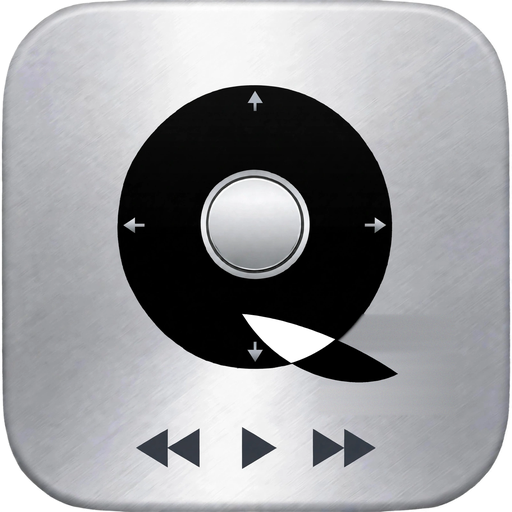

# Quiet Remote

**Download the app: [Quiet-Remote-v47.2.apk](https://github.com/Tsonnn/quiet-remote/releases/download/v47.2/Quiet-Remote-v47.2.apk)** — tap to download, then open it to install. Free, no ads, no account.

A free, ad-free Android remote for Vizio SmartCast TVs. No ads, no
account, no login, no monthly fee, no cloud. Your phone talks to the
TV directly over your home WiFi.



> Quiet Remote is an independent, open-source project. It is not
> affiliated with, endorsed by, or connected to VIZIO, Inc. VIZIO and
> SmartCast are trademarks of VIZIO, Inc.

## What it does

- **One app, all your TVs.** Tap a TV at the top to switch. Each TV
  is paired separately with its own PIN.
- **Apple-style remote.** A big touchpad you swipe to move around
  menus and tap to select, like the aluminium Apple TV remote.
- **Volume that jumps.** Drag the slider and the volume goes straight
  there — it does not creep up one step at a time. Tap the speaker
  icon to mute.
- **The usual buttons.** Power, mute, home, menu, back, and playback
  (rewind / play-pause / fast-forward).
- **YouTube and Netflix buttons** that open the apps on the TV.
- **Phone keyboard.** Type into YouTube search from your phone
  instead of hunting letters on the TV. The keyboard pops up by
  itself when you open it; Send types the text, and in YouTube the
  search runs by itself. Search presses Enter, DEL deletes a
  character, and Select picks the highlighted key on the TV.
- **Double-tap to select.** Double-tap anywhere on the touchpad to
  press OK — a single tap does nothing, so a tap while swiping will
  not select by accident.
- **Power button that tells the truth.** Green when the TV is on,
  red when it is off, grey while the remote cannot tell yet. It
  flips the moment you tap it, and the app opens fast by showing
  the last-known state at once.
- **Remove a TV.** A TV the app cannot find stays listed, dimmed.
  Take it off in Settings with REMOVE THIS TV.
- **Settings shows the real version** at the bottom, so you can
  always tell which build you have.
- **The Q icon.** The app's mark is a black touchpad disc as a Q
  on silver, drawn by hand — no stock art, no VIZIO logo.
- **Per-TV settings.** Sleep timer, picture mode, and closed captions
  for each TV.
- **It remembers your TVs.** If a TV's IP address changes, the app
  finds it again by its identity — no re-pairing.
- **A fresh install starts with zero TVs.** Nothing about any TV is
  baked into the app. Your TVs appear only after a live scan on your
  own WiFi.

## What it is not

- Not the official VIZIO app, and not affiliated with VIZIO, Inc.
- Android only. There is no iPhone version.
- It controls TVs over your home WiFi only. It does not work away
  from home, and it does not control soundbars or other devices.

## Install

1. Download `Quiet-Remote-v47.2.apk` from the
   [latest release](../../releases/latest).
2. On your phone, allow installing from unknown sources for your
   browser or file manager, then open the APK to install it.
3. Open Quiet Remote. The first-time setup walks you through three
   steps:
   1. **WiFi first.** Connect the phone to your home WiFi.
   2. **Find your TVs.** Tap FIND MY TVs. Your TVs appear as the
      app finds them on your WiFi.
   3. **Pair.** Tap a TV, tap PAIR, then type the 4-digit PIN shown
      on that TV's screen. Turn the TV on with its regular remote
      first — you can't see the PIN while the TV is off.

One note: power-on over WiFi only works if the TV is in Quick Start
mode (Settings > System > Power Mode > Quick Start on the TV). In
Eco Mode the TV is off the network when it is off, and the app
cannot find it or turn it on.

Your pairing is stored on your phone only, one per TV. Uninstalling
the app deletes the pairings.

## Compatibility

Quiet Remote uses the TV's own local SmartCast pairing
(HTTPS, port 7345). It has been tested on two SmartCast models so
far; it should work on other SmartCast models, but if it doesn't on
yours, please [open an issue](../../issues) with your TV's model
and what happened.

Known notes for this release:

- **Netflix has not been confirmed working yet.** The button has
  been there since v25.0 and uses the same launch mechanism as
  YouTube, but no one has confirmed it opens Netflix on a real TV
  yet. If tapping Netflix does nothing on your TV, please report
  it — the model and the exact message the app shows.
- The YouTube button uses the same launch mechanism and is confirmed
  working on the tested models.

## Build from source

No Gradle, no plugin downloads. The build uses only the Android SDK
build-tools already on your machine: `aapt2` (resources) →
`javac` → `d8` (dex) → `zipalign` → `apksigner`.

Requirements: Android SDK with build-tools 34.0.0 and platform
android-34, and JDK 17. Edit the `SDK` and `JAVA_HOME` paths at the
top of `build-apk.sh` if yours are elsewhere.

```sh
./build-apk.sh                # produces Quiet-Remote-v47.2.apk
./build-apk.sh my-build.apk   # custom output name
```

The APK is debug-signed, so it installs over a previous build from
this script and keeps pairings. The first build creates a
`debug.keystore` next to the script; keep that file if you want
later builds to install over earlier ones.

A build from a fresh clone makes a different debug keystore, so its
APK will NOT install over an APK built elsewhere — Android refuses
the install because the signature differs. (Uninstalling first
works, but it deletes the pairings.) The release APK here is the
one to install; build from source only if you want to change the
code.

Run the tests (plain JVM, no Android device needed):

```sh
./test/run-test.sh
```

## How it works (short version)

- **Discovery:** the app scans the phone's WiFi subnet for TVs with
  port 7345 open, then asks each TV for its identity — first the
  SmartCast device info on port 7345 (which answers even when the TV
  is in Quick Start standby), then the DIAL/UPnP description for the
  friendly name.
- **Pairing:** the standard SmartCast flow — `PUT /pairing/start`,
  the TV shows a 4-digit PIN, `PUT /pairing/pair` returns an auth
  token stored on the phone.
- **Commands:** key presses go to `PUT /key_command/`; settings
  read/write go to the TV settings endpoints, one fast single value
  at a time (never a full list fetch).
- **Volume:** the slider sets volume directly over the Cast protocol
  (TLS to port 8009), falling back to SmartCast key stepping if the
  Cast path does not land.
- **App launching:** YouTube and Netflix open via
  `PUT /app/launch` with the apps' documented launch configs
  (from the pyvizio app list).

## Contributing

Issues and pull requests are welcome. Please keep it to the spirit
of the app: no ads, no account, no tracking, no cloud, and no
private data baked in. A fresh install must still start with zero
TVs, and no user-visible string may contain a TV model or an IP
address — `./test/run-test.sh` checks both.

## License

MIT — see [LICENSE](LICENSE).
